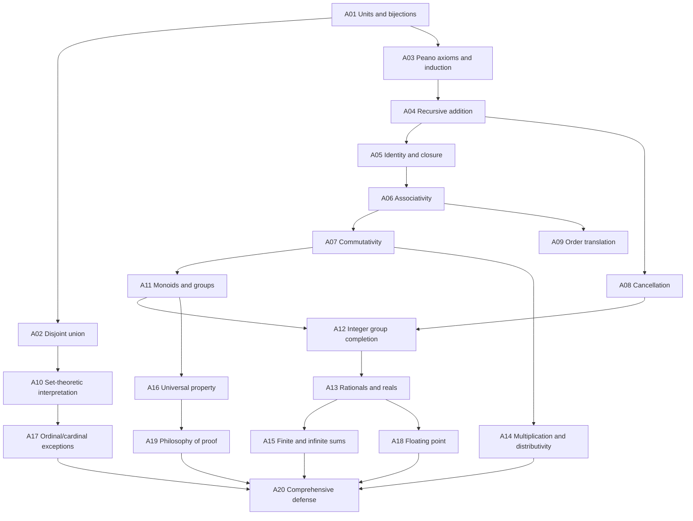
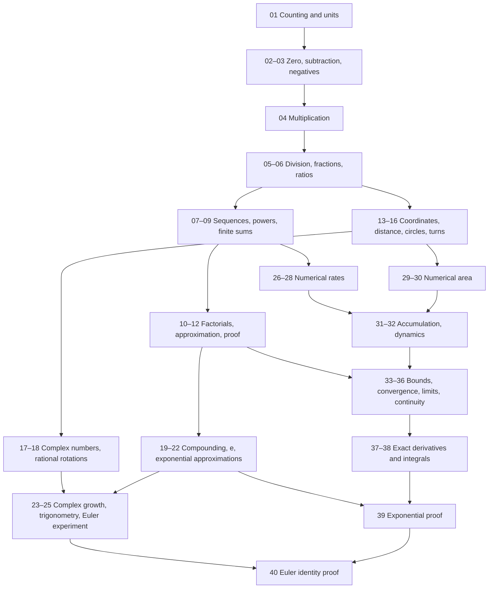

# Concept Dependencies & Learning Progress

This file is the readable companion to [CONCEPT_TRACKER.csv](CONCEPT_TRACKER.csv). The CSV is the **editable source of truth** for lesson status, scores, review dates, and notes. Detailed addition prerequisites live separately in [ADDITION_MASTERY.csv](ADDITION_MASTERY.csv).

## What the castaway remembers

The castaway can **count, add, subtract, multiply, and divide**, including ordinary calculations with fractions. These are remembered procedures, **not yet justified mathematical ideas**. He does not know why the rules work, when they fail, or how to reconstruct them from first principles.

He has scattered memories of school: **sine, cosine, angles, geometry, and linear equations**. He remembers only the words—not a single definition, identity, value, formula, or method. These are narrative clues, not usable mathematical knowledge.

**The challenge is no longer to invent arithmetic without knowing it. It is to justify familiar arithmetic, discover what it can do, and rebuild the forgotten mathematics of change.**

## The addition foundations branch

**The original 40 lessons are chapter milestones, not a complete prerequisite inventory.** Chapter 01 now has a rigorous optional-depth companion, [Interlude 01A](chapters/01a-laws-beneath-the-stones.md), with **20 separately trackable competencies** in [ADDITION_MASTERY.csv](ADDITION_MASTERY.csv). This avoids renumbering every later chapter.

**The diagram shows the main route, not every edge.** The complete, exact per-competency prerequisites are in the addition CSV. Core readiness for Chapter 02: main Lesson 01 plus A01–A02 (units, bijections, disjoint union). The main tracker explicitly lists these cross-tracker prerequisites. A03–A20 are the optional rigorous-depth branch; they become required only for the comprehensive addition-defense milestone. Deep mastery of addition: A01–A20 at score 4. Later chapters can rely on the core route while the foundations branch remains available.

**Important sequence distinction:** The formal interlude deliberately looks ahead to zero, negatives, multiplication, fractions, and limits. It is a **foundations appendix** that proves and classifies familiar ideas; it is not the chronological order in which the castaway discovers them in the main story.

## The learning path

The diagram groups chapters for readability. **Exact prerequisites for each individual lesson are in the CSV.** A chapter can have several prerequisites from different acts, and those are listed by lesson ID.

## How we track progress

| Status | Meaning |
|---|---|
| Not started | We have not studied the lesson |
| Learning | We are actively working through it |
| Practicing | We understand the idea but need independent examples |
| Mastered | We can pass the lesson's mastery check without help |
| Review | Previously mastered, but needs refreshing |

**Mastery scale:** 0 = unseen; 1 = recognize the idea; 2 = follow a worked example; 3 = solve independently; 4 = explain, derive, and apply in a new setting.

**Recommended unlock rule:** Begin a lesson when all its prerequisite lessons and cross-tracker concept IDs have a score of at least **3**. This is a study recommendation, not a mathematical theorem; we may deliberately explore ahead.

## Lesson routine

1. **The scene:** A short castaway episode poses one concrete need, sometimes prompted by a fragment of remembered mathematics.
2. **The notebook:** Use remembered arithmetic, then ask which rules justify the calculation.
3. **The invention:** Name the new operation or concept only after constructing it.
4. **The experiment:** Test the idea numerically and track error where possible.
5. **The check:** Solve one fresh problem without prompts.
6. **The ledger:** Record earned tools, observed patterns, and unproved claims.
7. **The tracker:** Update status, score, date, and one sentence of notes in the CSV.

## Example of a dependency

**Lesson 25 — Half a Turn** requires:

- **20:** Numerical approximations to e
- **23:** Complex compounding
- **24:** Numerical trigonometric patterns

It does **not** require limits: at this stage, the goal is to *test* Euler's identity numerically. Its exact proof belongs to Lesson 40, which requires the rigorous material developed later.

## Editorial decision: Story + mathematical notebook

The book uses **two complementary registers**:

**Story:** Brief, concrete, literary, and sometimes playful. The castaway remembers arithmetic procedures but cannot explain them; he recalls only the names of trigonometry, geometry, and linear equations, with no associated formulas or facts. A recurring castaway encounters a genuine problem on the island. No lecture disguised as dialogue, and no contrived survival problem merely to introduce a formula.

**Notebook:** Direct and precise. It shows the arithmetic, asks the reader to predict the next result, explains why an operation is needed, and records what is actually established. Numerical evidence is labeled as such.

Each lesson should be short enough to feel like one discovery. The story should never replace the calculation, and the calculation should never arrive before its motivation.

## Future editing

- Edit [ROADMAP.md](ROADMAP.md) to change the book's story and chapter plan.
- Edit [CONCEPT_TRACKER.csv](CONCEPT_TRACKER.csv) to track lesson mastery.
- Update the concept prerequisites whenever chapters are added, removed, or reordered.
- Keep all initial statuses at **Not started** until a mastery check is actually attempted.
